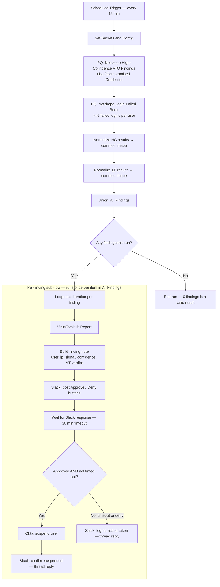

# Netskope Account Takeover Workflow — Deployment & Configuration Guide

This guide covers deploying **"Netskope Account Takeover — Detect, Enrich, Approve & Suspend"** (`netskope-ato-hyperautomation-workflow.json`) into a SentinelOne Hyperautomation console.

The workflow hunts three Netskope-native signals confirmed live in this tenant on 2026-07-15 (`unmapped.alert_type == "uba"`, `unmapped.alert_type == "Compromised Credential"`, `unmapped.activity == "Login Failed"` bursts), enriches the source IP via VirusTotal, and gates a Okta user-suspend behind Slack analyst approval.

---

## 1. Architecture at a glance



**Reading the diagram:** everything above the `Loop` box runs once per 15-minute schedule tick. Everything inside the `LOOP` box runs once *per finding* — if the hunt returns 3 findings in a given run, the enrich → notify → approve → remediate sequence executes 3 times, sequentially (not in parallel, to respect API rate limits).

---

## 2. Using Claude Cowork + SentinelOne MCP to build and extend this work

This workflow and guide were produced inside a Claude Cowork session wired to the `sentinelone-mcp` server and the `sentinelone-hyperautomation` skill, running under this project's `CLAUDE.md` operating rules (live schema discovery before any query, no fabricated field names, mark assumptions explicitly). This section explains the tools involved and gives copyable prompts so you can reproduce, re-validate, or extend this work the same way.

### 2.1 What was involved

| Component | Type | Role in this work |
|---|---|---|
| `sentinelone-mcp` | MCP server | Exposes PowerQuery and Hyperautomation as callable tools, running locally so calls to `*.sentinelone.net` bypass the sandbox proxy |
| `sentinelone-hyperautomation` | Skill | Supplies the Hyperautomation JSON schema, building-block reference, function reference, and a validation checklist — read *before* generating any workflow JSON |
| Cowork elicitation form | Built-in Cowork UI | Collected which Netskope signals, response actions, approval gate, and notification channel to include, before the JSON was generated |
| Cowork task/file tools | Built-in | Wrote and validated the JSON and this guide, and copied final versions into the shared project folder |

### 2.2 The session flow

The diagram in Section 1 shows the workflow that resulted from this process — it's the only diagram in this guide. The session that produced it followed this sequence:

1. **Enumerate SDL data sources** (`powerquery_enumerate_sources`) — confirmed Netskope, Okta, CloudTrail, and CrowdStrike Falcon are live in this tenant.
2. **Discover the Netskope field schema** (`powerquery_schema_discover`) — pulled real field names instead of assuming a documented schema.
3. **Query the Netskope `alert_type` / `activity` taxonomy** (`powerquery_run`) — this is what surfaced `"uba"` and `"Compromised Credential"` as the real ATO-relevant values, instead of guessing at generic "Login" or "Anomaly" labels.
4. **Check whether Netskope findings already reach the native S1 alert stream** (`powerquery_run`) — they don't (`detectionSource.product` was null across all sampled alert rows), which is what ruled out a `singularity_response_trigger` design in favor of the scheduled PowerQuery-hunt pattern the workflow actually uses.
5. **List existing Hyperautomation workflows** (`ha_list_workflows`) — checked for duplicates and confirmed a SentinelOne connection was already configured and in active use.
6. **Load the `sentinelone-hyperautomation` skill and its reference docs** — schema, building blocks, functions, and validation rules, read before generating any JSON.
7. **Elicit requirements via the Cowork form** — which signals, response actions, approval gate, and notification channel to include.
8. **Generate the workflow JSON** and validate `export_id` uniqueness, edge targets, and `parent_action` references.
9. **Write this deployment guide.**
10. **(Optional, not yet run)** `ha_import_workflow` — import as a draft to the console.

### 2.3 Prompts you can reuse

Paste these into a Cowork session with the same MCP server connected to re-run or extend this work:

- *"Enumerate all SDL data sources in my SentinelOne tenant."*
- *"Discover the field schema for the Netskope data source and list the confirmed fields."*
- *"Show me the distinct `unmapped.alert_type` and `unmapped.activity` values for Netskope events over the last 30 days."*
- *"Check whether Netskope findings already appear in the native SentinelOne alert stream, or if I'd need a STAR rule to bridge them."*
- *"List my active Hyperautomation workflows so I don't duplicate one that already exists."*
- *"Suggest a Hyperautomation workflow for account takeover actions based on Netskope events."* — this is the prompt that started this build.
- *"Add a guided introduction on how to use the MCP servers and prompts in Claude Cowork to create the work."* — this section, generated from the same session's own tool-call history.
- *"Import this workflow into my console as a draft using `ha_import_workflow`."* — not yet run in this session; say the word if you want it pushed live.

### 2.4 Why order matters here

The skill's own instructions (`SKILL.md`) specify reading `building-blocks-catalog.md` first to pick the right pattern, then `workflow-schema.md` and `building-blocks.md` for exact field shapes, then self-checking against `validation-rules.md` before presenting any JSON. Skipping straight to JSON generation without that reading order is the most common source of invalid `export_id` wiring, wrong `condition_type`, or fabricated integration IDs — all of which the validation pass in this session was built to catch.

---

## 3. Prerequisites

| # | Requirement | Why it's needed | Where to get it |
|---|---|---|---|
| 1 | SentinelOne console connection (Hyperautomation → Integrations → SentinelOne) | Both PowerQuery steps call `{{Connection.protocol}}{{Connection.url}}/sdl/api/powerQuery`, which resolves through this connection | Already configured in this tenant — 7 of the 8 active workflows use it. Confirm it's still valid before importing. |
| 2 | VirusTotal API key | IP reputation lookup on every finding's source IP | VirusTotal account → API key (Community tier is enough for on-demand IP lookups at this volume) |
| 3 | Slack bot token (`xoxb-...`) with `chat:write` scope | Posts the Approve/Deny message and thread replies | Slack app admin → OAuth & Permissions → Bot Token Scopes → `chat:write` |
| 4 | Slack channel | Where ATO findings land for analyst review | Create e.g. `#soc-ato-alerts`; invite the bot user to it |
| 5 | Okta API token | Calls `/api/v1/users/{id}/lifecycle/suspend` | Okta Admin Console → Security → API → Tokens → create token as a user with **User Administrator** (or broader) role |
| 6 | Okta org subdomain | Builds the Okta API base URL | e.g. `yourcompany` for `yourcompany.okta.com` |
| 7 | Personal Console User API token (not a Service User token) | Used only if importing via the Hyperautomation API instead of the console UI | SentinelOne console → My User → API Token. Service User tokens import workflows invisibly to the UI — avoid them. |

**Assumption:** the `wait_for_slack` action correlates a button click back to the posted message via Hyperautomation's own Slack integration (Events/Interactivity), separately from the raw bot token used for `chat.postMessage`. If button clicks in Step 7 below don't register, configure a Slack connection under **Hyperautomation → Integrations → Slack** in addition to the bot token. **Falsified by:** a successful approve/deny click being received during the Step 7 test run without that integration configured.

---

## 4. Step-by-step deployment

### Step 1 — Confirm the SentinelOne connection
In the console, go to **Hyperautomation → Integrations** and confirm a SentinelOne connection already exists and is healthy. This tenant's other active workflows (e.g. *CrowdStrike Falcon Alert Enricher*) already depend on it — if it's broken, those break too, so this is a low-risk check.

### Step 2 — Create the Slack app / bot token
1. Create (or reuse) a Slack app with `chat:write` bot scope.
2. Install it to your workspace, copy the `xoxb-...` bot token.
3. Create `#soc-ato-alerts` (or your preferred channel name) and `/invite` the bot.
4. If your tenant requires the Hyperautomation-native Slack integration for interactive buttons (see Assumption above), configure that connection now too.

### Step 3 — Create the Okta API token
1. In Okta Admin Console: **Security → API → Tokens → Create Token**.
2. Create it under an account with **User Administrator** privileges (minimum needed to call the suspend lifecycle endpoint).
3. Copy the token immediately — Okta only shows it once.

### Step 4 — Import the workflow JSON
Two options:

**Option A — Console UI**
Hyperautomation → Workflows → Import → upload `netskope-ato-hyperautomation-workflow.json`. It lands as a private draft.

**Option B — API / MCP** (bypasses proxy issues)
```
ha_import_workflow(
  workflowJson=<contents of netskope-ato-hyperautomation-workflow.json>,
  siteIds="<your-site-id>"   # or accountIds="<your-account-id>"
)
```
On a scoped tenant, a bare import with no `siteIds`/`accountIds` can return a misleading `403 Insufficient permissions` — always pass scope explicitly.

### Step 5 — Fill in real secrets
Open the imported draft, find the **"Set Secrets and Config"** action (second node after the trigger), and replace the five placeholder values:

| Variable | Replace with |
|---|---|
| `virustotal_api_key` | Your VirusTotal API key |
| `slack_bot_token` | Your Slack bot token (`xoxb-...`) |
| `slack_channel` | Your channel, e.g. `#soc-ato-alerts` |
| `okta_domain` | Your Okta subdomain, e.g. `yourcompany` |
| `okta_api_token` | Your Okta API token |

All five are marked `is_secret: true` where sensitive (VT key, Slack token, Okta token), so they're redacted from execution logs in the console UI.

### Step 6 — Re-bind the SentinelOne connection
Because the workflow was generated with `connection_id: null` (required for portable import), open the two PowerQuery actions (**"PQ - Netskope High-Confidence ATO Findings"** and **"PQ - Netskope Login-Failed Burst"**) and select your SentinelOne connection from the dropdown if it isn't auto-resolved.

### Step 7 — Test run before activating
1. Use the console's manual "Run now" / test option on the draft (do **not** wait for the schedule).
2. Confirm the two PowerQuery steps return columns matching what's expected (`actor.user.email_addr`, `src_endpoint.ip`, etc.) — if either query 500s, re-run schema discovery, Netskope field names can drift between sessions.
3. If the hunt returns 0 findings (likely, outside an active incident), temporarily widen the `startTime` in one query (e.g. `"30d"`) to force a test hit, confirm the Slack message and buttons render, click Approve, and confirm the Okta call fires — then revert the `startTime` back to `"20m"`.
4. Click Deny on a second test to confirm the "no action taken" thread reply path also works.

### Step 8 — Activate
Once the test run behaves as expected, set the workflow **state to Active** and confirm the Scheduled Trigger shows `interval: 15 minutes` in the console's trigger view.

---

## 5. Validation checklist

- [ ] SentinelOne connection resolves in both PQ steps (no 401/403)
- [ ] `virustotal_api_key`, `slack_bot_token`, `okta_domain`, `okta_api_token` all replaced with real values
- [ ] Bot is a member of the target Slack channel
- [ ] Test run: Approve path suspends a **test** Okta user and posts a confirmation thread reply
- [ ] Test run: Deny / timeout path posts a "no action taken" thread reply and does **not** call Okta
- [ ] Workflow state is `active` and trigger is `interval / 15 minutes`
- [ ] `imported by` uses a personal Console User token, not a Service User token (otherwise the workflow won't show up for other analysts in the UI)

---

## 6. Troubleshooting

| Symptom | Likely cause | Fix |
|---|---|---|
| Both PQ steps return 0 rows even though you know Netskope has recent activity | Netskope field/alert-type taxonomy has drifted since 2026-07-15 discovery | Re-run schema + taxonomy discovery (`array_agg_distinct(unmapped.alert_type)` etc. over the Netskope source) and update the two PQ queries |
| PQ step returns `matchCount=0` despite data existing | Multi-account scoping — `tenant: true` in the underlying LRQ call defaults to one account | Re-run with explicit `accountIds` for the account carrying Netskope data |
| Slack message posts, but clicking Approve/Deny never resumes the workflow | Hyperautomation's Slack integration (Events/Interactivity) isn't configured, only the raw bot token is | Configure the Slack connection under Hyperautomation → Integrations (see Assumption in Prerequisites) |
| Okta call returns 403 | API token's role doesn't include user lifecycle management | Regenerate the token under a User Administrator (or higher) Okta role |
| Workflow imports but is invisible in the console UI to other analysts | Imported with a Service User API token | Re-import using a personal Console User token |
| `condition` step behaves unexpectedly on the "in" operator (not used in this workflow, but if you extend it) | `compared_value` passed as a raw array instead of a JSON-encoded string | Encode as `"[\"HIGH\",\"CRITICAL\"]"`, not `["HIGH","CRITICAL"]` |

---

## 7. Customization notes

- **Fully automatic mode:** delete the `Wait for Slack` and `Analyst Approved Suspend` condition, and connect `Slack - Post ATO Finding for Review` directly to `Okta - Suspend User`. Not recommended without a compensating control (e.g. a post-hoc audit report) since suspend actions become irreversible-in-practice without analyst review.
- **Different timeout vs. deny handling:** the current `Analyst Approved Suspend` condition treats timeout and explicit deny identically (both fall to the "no action" branch). Split it into two conditions if you want, for example, auto-escalation to a secondary on-call channel on timeout only.
- **Add email as a second channel:** duplicate the `Slack - Post ATO Finding for Review` action as a `send_email` action (see `functions-reference.md` / `building-blocks.md` in the Hyperautomation skill) in parallel with the Slack post.
- **Broaden the signal set:** the `PQ - Netskope High-Confidence ATO Findings` query currently matches `unmapped.alert_type in {"uba","Compromised Credential"}`. This tenant's live taxonomy also includes `"Malware"`, `"malsite"`, `"policy"`, and `"DLP"` — add any of these to the `OR` clause if you want them treated as ATO-relevant.

---

## 8. Notes on data provenance

Every field name and Netskope alert-type value in the workflow's PowerQuery steps was confirmed via live schema discovery and a taxonomy query against this tenant's SDL on **2026-07-15** — not assumed from documentation. Re-validate before making major changes, per this environment's operating rule that schemas and taxonomies can drift between sessions due to parser edits and ingestion changes on the Netskope side.
